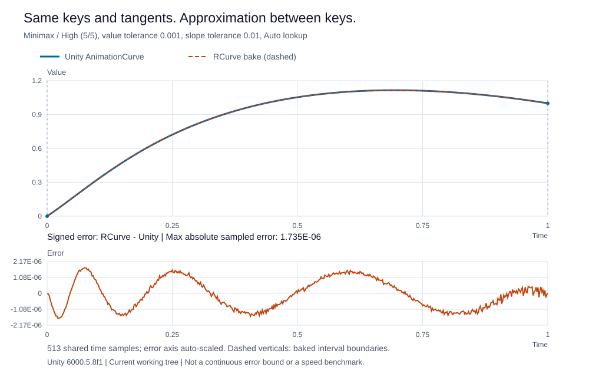
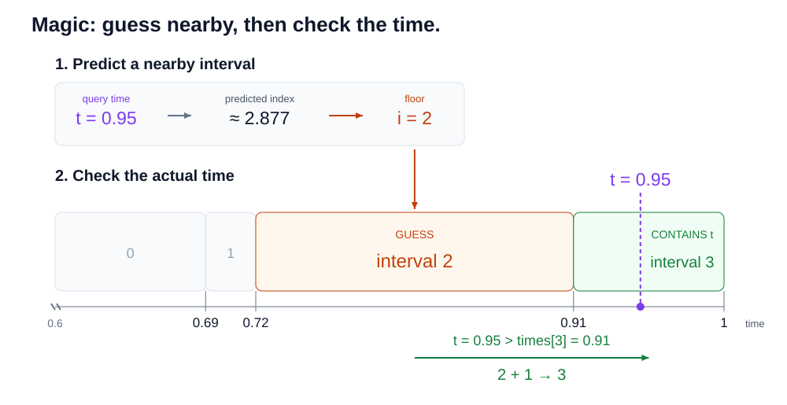

# RCurve 사용 가이드

## 1. 무엇을 바꾸는가

원본 AnimationCurve는 그대로 편집한다. 기본 흐름은 Editor에서 구간별 rational 함수로 bake하고 플레이어에서 저장된 계수를 평가하는 것이다. 런타임에 사용자가 만든 커브는 명시적으로 `Bake()`할 수도 있다.

**애니메이션 키의 값과 양쪽 유한 접선 기울기는 경계 조건으로 보존하고, 키 사이만 근사한다.** 좌우 접선이 다른 키는 `inTangent`와 `outTangent`를 각각 보존한다. 키 사이의 높이/기울기는 지정한 허용 오차 안에 있음을 구간마다 증명한다(7절). Unity의 `AnimationCurve.Evaluate`와 비트 단위로 같은 값을 내는 변환은 아니다.

계단은 별도 규칙으로 처리한다. 좌우 기울기/값이 이어지지 않는 키에는 하나의 공통 미분값이 없으므로 `EvaluateSlope`는 NaN을 반환할 수 있다. 범위 밖 시간과 Loop의 마지막 시각은 원본 WrapMode로 먼저 매핑한다.

- 사용자 필드: `RationalCurve` (`RCurve.Unity`)
- 불변 관리형 결과: `BakedRationalCurve` (`RCurve.Runtime`, UnityEngine 참조 없음)
- Job용 스냅샷: `NativeRationalCurve` (`RCurve.Burst`)
- fitting: `RationalCurveBuilder` (`RCurve.Unity`, Editor/player 공용)

기본값은 **Minimax / High(5/5) / Lookup Auto**다.



위는 실제 값이며 확대하지 않았다. 아래만 오차를 독립적인 축으로 표시한다. RCurve 0.3.0과 Unity 6000.5.8f1, 기본 설정으로 생성했으며, 이 예시의 513개 공통 시각에서 최대 절대 오차는 약 **1.73 × 10⁻⁶**이다. 한 커브의 측정값이며, 보장은 7절의 오차 기준이다. [입력·원시 데이터·재생성 방법](graphs.md)을 참고한다.

## 2. Inspector에서 편집

```csharp
using RCurve;
using UnityEngine;

public class Motion : MonoBehaviour
{
    [SerializeField] private RationalCurve _curve = new RationalCurve();
    private int _intervalHint = -1;

    private void Update()
    {
        double value = _curve.Evaluate(Time.time, ref _intervalHint);
        // 순차 접근이 아니면 _curve.Evaluate(Time.time)를 사용한다.
    }
}
```

일반 Inspector는 `▶ 이름 [곡선]` 한 줄이다. 펼치면 목적함수, 차수, 높이/기울기 오차, 최대 분할 깊이, Lookup Mode가 나온다. 마지막 편집 후 0.35초가 지나고 드래그가 끝나면 bake한다. Inspector에 그려지지 않은 필드도 `Undo.RecordObject`로 기록된 수정이면 같은 방식으로(스크립트에서 부른 `SerializedObject.ApplyModifiedProperties`는 Unity가 Undo 수정 이벤트를 내지 않으므로 그런 도구는 `CurveAutoBuild.Queue`를 호출한다), 디스크에서 다시 임포트된 `.asset`/`.prefab`(텍스트 수정, 머지)은 즉시 bake해 저장하고, 씬은 열 때 bake한 뒤 dirty로 표시한다. Play Mode에서는 fitting하지 않는다.

- 기본 오차: 높이 0.001, 기울기 0.01, 최대 분할 깊이 8.
- 차수: Low 3/3, Medium 4/4, High 5/5, XHigh 6/6.
- 실패하면 마지막 정상 bake를 유지하고 오류를 표시한다. 처음부터 bake가 없으면 평가 시 예외다.
- 불러온 뒤 첫 평가 때 원본/설정 해시를 bake 때의 해시와 비교한다. 달라졌으면(Undo 없는 에디터 도구의 수정, 텍스트 수정, 머지, 실패한 재bake) 예전 bake로 평가하지 않고 예외다. 원본은 직렬화(Inspector, 에셋 파일)로만 바뀐다. 코드에는 복사본(`CopySource()`)만 주고, 생성자도 받은 커브를 복사한다.
- 원본/설정/bake는 직렬화된다. Undo/Redo와 관찰 중인 필드의 저장 전 대기 bake를 지원한다.
- bake 정보는 기본 Debug Inspector의 `_baked`에서 본다. 별도 디버그 토글은 없다.

## 3. 구간 탐색 모드

곡선의 차수/정확도와 **어느 구간인지 찾는 방법**은 별개다. 탐색 모드를 바꾸어도 구간을 균일하게 만들거나 값을 재근사하지 않는다.

| 설정 | 동작 | 주의 |
|---|---|---|
| Auto (기본) | bake 시 비용 모델로 선택 | 관리형/Burst가 서로 다른 전략을 고를 수 있음 |
| BruteForce | 실제 경계를 순서대로 비교 | 구간 수가 많으면 느림 |
| LUT | 시간 셀에서 후보 구간을 찾고 실제 경계로 보정 | 최대 1 KiB/커브, 셀에 여러 구간이 있으면 범위 내 이진 검색 |
| Magic | 전역 1차/3차 예측 함수의 floor + 최대 한 칸 보정 | 인증 실패 시 이진 검색 |

이진 검색은 Auto의 후보이자 안전한 fallback이다. 일반 Inspector의 별도 선택지는 아니다. 모든 경로는 정확한 키 값, step, WrapMode, 기울기 의미를 유지한다.

Auto/Magic에서만 인덱스 예측기를 fitting한다. 선형 최소제곱 예측을 먼저 시도하고, 인증에 실패하면 키가 4개 이상일 때 3차를 시도한다. 각 후보는 키 인덱스 잔차의 최솟값·최댓값이 대칭이 되도록 상수항을 보정한 뒤 단조성과 모든 키에서의 오차 한도를 다시 인증한다. 전체 계수를 minimax로 최적화하는 것은 아니다. BruteForce/LUT를 명시하면 예측기를 만들지 않는다.



**Magic은 커브 값이 아니라 값을 평가할 구간을 찾는다.** Bake할 때 `(bake 결과의 키 시간, 키 인덱스)`를 근사하는 전역 1차/3차 다항식을 저장한다. 여기에는 fitting 중 분할로 추가된 구간 경계도 포함된다. 이 예시에서는 1차가 선택됐다. 그림은 수식 대신 **주황색 후보 구간과 초록색 실제 구간을 같은 시간축에서 비교**한다. 보라색 시각은 고정되어 있고, 화살표는 시각이 아니라 선택 구간이 바뀐다는 뜻이다.

실행 시에는 다음 순서로 처리한다. 유효한 interval hint가 먼저 적중하는 경로는 이 예시에서 제외했다.

1. WrapMode를 적용한 시각으로 인덱스를 예측한다: `t=0.95 → f(t)≈2.877`.
2. floor와 범위 제한으로 후보 구간을 얻는다: `i=2`.
3. **실제 키 경계**와 비교한다. 후보는 `[0.72, 0.91)`인데 `t≥0.91`이므로 한 칸 오른쪽인 `i=3`으로 보정한다. 반대로 후보 왼쪽이면 한 칸 왼쪽으로, 내부면 그대로 둔다.
4. 보정된 `[0.91, 1)`에 시각이 들어가는지 확인하고 `segment[3].Evaluate(0.95)`로 실제 값 약 `1.175`를 얻는다. 예측 인덱스 `2.877`, 구간 번호 `3`, 커브 값 `1.175`는 서로 다른 값이다.

정확한 키 시각은 저장된 키 값을 반환한다. Bake 시 예측기 검증이 실패하거나 실행 중 보정된 구간 확인이 실패하면 이진 검색을 사용한다. 그림의 시간축은 `0.60–1.00`으로 확대했으며, 칸 너비는 실제 시간 간격에 비례한다. 왼쪽 구간 0은 일부만 보인다. [입력과 검증 방법](graphs.md)을 참고한다.

### Auto는 무엇을 기준으로 선택하나

`Unity/CurveLookupPlanner.cs`는 무작위 접근 벤치마크로 보정한 상대 비용 모델이다. 매 bake마다 Stopwatch/Burst 컴파일을 실행하지 않고 다음 정보를 사용한다.

- 균일한 mapped-time 256개 지점의 평균 선형 비교 수
- 이진 검색 깊이
- LUT 셀의 후보 범위와 추가 검색 빈도
- Magic의 한 칸 보정 빈도와 인증 성공 여부

관리형/Burst 비용 계수는 별도다. LUT는 최대 256개의 int(1,024바이트)로 제한하고, 두 backend 모두 LUT를 선택하지 않으면 저장하지 않는다. 가장 낮게 **추정된** 비용의 후보를 저장한다. 실제 CPU, 컴파일 옵션, 캐시 상태, 순차/랜덤 입력에 대해 항상 최속이라는 보장은 아니다. 교체 실측은 `CurveLookupStrategyTests.StrategiesMatchAndCalibrateAuto`로 반복할 수 있다.

Debug Inspector: `LookupMode`, `ManagedLookup`, `BurstLookup`, `LookupTable`, `LookupScale`, `LookupFallbackReason`.
코드: `curve.BakedCurve.ManagedLookup`, `.BurstLookup`. (lookup 표와 예측식은 0.5.0부터 internal이며 Debug Inspector로 본다.)

## 4. 값, 기울기, 선택적 힌트

```csharp
double y = curve.Evaluate(time);
double slope = curve.EvaluateSlope(time); // 입력 시간에 대한 dy/dt

int intervalHint = -1; // 재생 스트림 시작 시 한 번
// 이후 프레임/샘플에 같은 변수를 전달:
y = curve.Evaluate(time, ref intervalHint);
```

힌트는 필수가 아니다. 현재/앞뒤 한 구간에서 찾지 못하면 선택한 탐색 전략으로 돌아간다. 큰 seek에서 전체 구간을 순차로 걸어가지 않는다. 잘못되거나 다른 커브의 힌트도 경계 확인 후 사용한다.

- 힌트는 호출자/재생 스트림별 상태다. 커브 내부 공유 캐시는 없다.
- 순차 접근에서 도움이 되지만 랜덤 접근은 오히려 느려질 수 있다.
- Job에 넣은 일반 int는 복사된다. 다음 Job에서 재사용하려면 결과 힌트를 호출자 소유 저장소로 전달해야 한다. 여러 writer가 같은 힌트를 공유하지 않는다.
- scalar 기울기 API는 `EvaluateSlope`다. 기존 `EvaluateDerivative` 호환 별칭은 제거했다. 힌트 오버로드는 Evaluate에 제공한다.
- Clamp 외부의 slope는 0, PingPong 반사 구간에서는 부호가 반대다. 미분 불가능한 키/반복 이음새는 NaN이다.
- Unity 6.6 실측에서 Default는 Loop처럼 동작한다. post Loop/Default의 정확한 마지막 시간도 첫 키로 매핑한다.

## 5. 코드에서 bake / Burst 스냅샷

Editor 코드에서:

```csharp
var settings = new CurveFitSettings(
    CurveFitObjective.Minimax, CurveFitQuality.High,
    lookupMode: CurveLookupMode.Auto);
var editable = new RationalCurve(sourceAnimationCurve, settings);
editable.Bake();
```

Inspector 밖에서 source를 수정하는 Editor 도구는 `SerializedProperty`로 수정한다. `Undo.RecordObject`로 기록한 수정과 디스크에서 다시 임포트된 `.asset`/`.prefab`은 자동으로 bake되고, 그 밖의 경로는 CurveAutoBuild.Queue를 명시적으로 호출한다. 플레이어에서 사용자가 만든 커브는 완성된 AnimationCurve로 새 RationalCurve를 만들어 한 번 bake한다:

```csharp
var runtimeCurve = new RationalCurve(userAnimationCurve);
runtimeCurve.Bake(); // 할당과 fitting 비용이 있으므로 매 프레임 호출하지 않는다.
double value = runtimeCurve.Evaluate(time);
```

`Bake()`는 동기식이며 실패 시 예외를 전달한다. 미리 정해진 커브는 Editor bake를 유지하는 편이 로딩 비용이 작다.

```csharp
using var native = NativeRationalCurve.Create(editable.BakedCurve, Allocator.TempJob);
// [BurstCompile(FloatMode = FloatMode.Strict, FloatPrecision = FloatPrecision.High)] Job에 전달.
// Job에서 native.Evaluate(time) 또는 native.Evaluate(time, ref intervalHint).
// scope를 나가기 전에 모든 reader의 JobHandle.Complete().
```

Native 스냅샷은 bake 결과와 선택된 Burst 전략을 복사한다. 재bake 시 새 스냅샷을 만든다. 구조체 복사본은 메모리를 공유하므로 모든 읽기 완료 후 소유자 하나만 Dispose한다. 메인 스레드에서 호출한다고 자동으로 Burst가 되는 것은 아니다.

## 6. 나란히 비교하는 씬

Package Manager에서 **RCurve → Samples → Curve Comparison → Import** 후, 가져온 폴더의 **`Comparison.unity`** 를 열고 직접 Play한다. UI는 **Canvas/uGUI**이며 씬 Hierarchy의 `Comparison Canvas / Dashboard`에서 직접 편집할 수 있다. 큰 값 카드와 색상 구분, CanvasScaler를 사용하고 카메라 영역은 UI 아래로 맞춘다. UI Toolkit/IMGUI 기반 비교 HUD는 사용하지 않는다.

- 파란 구체(왼쪽): Unity AnimationCurve.
- 주황 구체(오른쪽): 저장된 RationalCurve, 같은 float 시간 입력.
- Play/Pause, Reverse, Reset, 시간 슬라이더, interval hint 토글.
- 원본 값, rational 값, 절대 오차, 관찰한 최대 오차, 실제 탐색 전략 표시.
- “키 값/유한 접선은 보존, 키 사이는 근사”를 씬에도 표시한다.
- 오차 막대만 x1000 확대한다. 두 오브젝트의 실제 위치는 확대하지 않는다.

`Curve Comparison - select to edit source and lookup mode` 오브젝트의 Curve를 **Play를 멈춘 뒤** 편집한다. 자동 bake가 끝난 다음 다시 Play한다. 한 실행 동안 source/bake 스냅샷을 고정하며, 실행 중에는 fitting하지 않는다.

이 씬은 **움직임과 근사 오차를 보는 도구**다. 두 오브젝트와 Canvas UI의 프레임 시간으로 알고리즘의 성능 차이를 판단하지 않는다. 성능은 아래 독립 벤치마크를 사용한다.

씬의 프리미티브/material은 Built-in `Unlit/Color`를 사용한다. URP/HDRP에서는 데모 material을 해당 파이프라인용으로 교체해야 할 수 있다. 곡선 평가 코드 자체는 렌더 파이프라인을 참조하지 않는다.

씬 생성 소스는 `Samples~/Comparison/Editor/CurveComparisonSceneBuilder.cs`다. 먼저 Package Manager에서 샘플을 가져온다. 재생성은 열린 씬을 건드리지 않도록 **별도 복사 프로젝트의 batchmode**에서만 실행한다:

```sh
Unity -batchmode -nographics -projectPath /path/to/isolated-project \
  -executeMethod RCurve.Demo.Editor.CurveComparisonSceneBuilder.Create -quit -logFile /tmp/rcurve-demo.log
```

생성된 Comparison.unity와 Materials를 가져온다. 기존 SampleScene은 교체하지 않는다.

기존 비교 씬의 **커브/bake를 유지하고 UI만 교체**하려면 별도 복사 프로젝트에서 `-executeMethod RCurve.Demo.Editor.ComparisonCanvasBuilder.UpgradeExisting`를 실행한다. Canvas, CanvasScaler, GraphicRaycaster, EventSystem과 실제 Text/Button/Slider/Toggle 오브젝트를 저장한다.

### uGUI와 Unity 6 버전

- `com.unity.ugui: 2.0.0`을 선언한다. Editor가 내장 최신판으로 대체할 수 있으며 Unity 6.6에서 실제 해석 버전은 2.6.0이다.
- 기본 Canvas/uGUI API와 `LegacyRuntime.ttf`를 사용한다. TMP나 UIElements에 직접 의존하지 않는다. 6.0~6.6 공통 API를 목표로 하되 실제 미실행 버전을 검증 완료라고 표현하지 않는다.
- 제공 씬은 Legacy Input Manager용 StandaloneInputModule을 사용한다. Input System 전용 호스트에서는 EventSystem을 InputSystemUIInputModule로 바꾸고 UI Actions를 연결한다. 씬 생성 도구는 해당 입력 설정에서 Input System 모듈을 선택하며, 프로젝트에 없는 Input System 패키지를 임의로 추가하지 않는다.
- 기존 Burst 1.8.18은 Unity 6.5의 TreeView API 변경과 충돌했다. manifest를 Unity 6.0 이상을 지원하는 Burst 1.8.30으로 갱신했다. PackageCache 소스는 수정하지 않는다.

## 7. 계약 (1.0에서 고정할 약속)

- **오차 기준.** `MaxValueError`는 값 단위의 절대 오차, `MaxSlopeError`는 시간당 값 단위의 절대 오차다. 둘 다 bake된 각 구간 안의 모든 시각에서, 키가 정의하는 정확한 커브(weighted Bezier, double 정밀도)를 기준으로 성립하며 표본이 아니라 구간마다 증명된다. 키 값과 유한한 키 접선은 그대로 재현한다. 키 범위 밖 시각은 WrapMode로 먼저 매핑한다.
- **기준은 Unity 평가기가 아니다.** weighted가 아닌 구간에서는 RCurve와 `AnimationCurve.Evaluate`가 값 오차 + float 반올림 안에서 일치한다. weighted 구간에서는 Unity의 solver가 자기 Bezier를 벗어날 수 있다. 500개 커브 차등 테스트에서 1개 커브가 0.02 어긋났고, 키 시각에서도 키 값을 돌려주지 않았다. RCurve는 정의를 따른다.
- **실패는 예외다. 품질이 낮은 커브를 대신 돌려주지 않는다.** `RationalCurveBuilder.Build`와 `RationalCurve.Bake`는 잘못된 입력(유한하지 않은 값, 증가하지 않는 시각, [0,1] 밖 가중치, 잘못된 설정)에 `ArgumentException`(또는 하위 타입)을, 유리함수로 표현할 수 없는 입력(길이 0 핸들 등 dx/ds=0)에 `NotSupportedException`을, `MaxSubdivisionDepth` 안에서 오차 기준을 맞출 수 없거나 solver 반복 한도에 닿으면 `InvalidOperationException`을 던진다. 에디터 자동 bake는 실패를 `BuildError`에 기록하고 마지막 정상 bake를 에셋에 남기지만, 그 뒤 평가는 예외다. bake되지 않은 커브, bake 이후 원본·설정이 바뀐 커브, 더 새 형식으로 bake된 커브도 마찬가지다.
- **버전이 붙은 bake.** bake마다 데이터 형식(`1`)과 bake한 RCurve 버전을 기록한다. 더 오래된 형식은 계속 읽고, 더 새 형식은 잘못 읽는 대신 거부한다.
- **결정론.** 같은 RCurve 버전·원본·설정이면 계수가 비트 단위로 같다. fitting에 난수와 스레드를 쓰지 않는다. 한 에디터 안에서 테스트했고, OS·CPU·.NET 런타임이 다를 때의 비트 동일성은 검증하지 않았으며 약속하지 않는다.
- **공개 표면.** `RationalCurve`, `CurveFitSettings`와 그 enum, `RationalCurveBuilder.Build`, `BakedRationalCurve`(평가, 키, 구간, wrap·lookup 진단), `RationalCurveSegment`(평가), `NativeRationalCurve`, lookup enum, `CurveAutoBuild.Queue`/`FlushPending`. 나머지는 internal이다.

## 8. 검증과 알려진 한계

- `CurveLookupStrategyTests`: 같은 bake의 BinarySearch / BruteForce / LUT / Magic / Auto 비교, 실제 Burst 값/기울기 실행, 정확한 키/인접 double/랜덤 입력, 저장 복원, LUT 안전성.
- `RationalCurveBenchmarkTests`: Unity / rational / Burst 랜덤 접근 비교.
- `RationalCurveHintBenchmarkTests`: 정방향/역방향/Loop/1% seek/랜덤 접근의 힌트 유무 비교.
- `CurveComparisonSceneTests`: 저장된 데모 bake/마커/오차를 Edit Mode에서 확인. 실제 Play/렌더링 검증과는 다르다.
- `SegmentCertificateTests`: Bernstein 부호 판정, 합성·구간 제한의 정확성, 실제 fit 구간에서 촘촘한 실측 최대 오차의 1.05배는 증명되고 0.95배는 거부되는지.
- `CurveChangeTrackingTests`: Inspector 밖 자동 bake 세 경로(`Undo.RecordObject` 수정, 디스크에서 바뀐 에셋의 재임포트, 씬 열기)와 수정된 속성 경로에서 커브를 찾는 규칙.
- `ContractTests`: 형식 버전 기록과 더 새 형식 거부, 재bake의 비트 동일성, 500개 무작위 커브의 정확한 원본 대비 오차 한도(전부 단언)와 Unity 대비(weighted가 아닌 구간만 단언), 경계 케이스(키 1개·0개, 길이 0/최대 핸들, 범위 밖 가중치, 계단, 같은 시각·역순 키).

속도에 pass/fail 한도를 걸지 않는다. 비용 모델은 특정 에디터/CPU에서 보정한 정책이며 플레이어/AOT의 최속 보장이 아니다.

알려진 한계: dx/dt=0인 weighted 구간 거부, 증명되지 않는 구간은 분할하므로 구간 수가 표본 검증 때보다 늘 수 있음(무작위 300개 커브에서 +1.6%), 큰 weighted 입력 일부에서 Minimax simplex 반복 한도 초과, JsonUtility의 double 십진 왕복에서 수 ULP 변화 가능. Unity 6.0, URP/HDRP 호스트 및 IL2CPP 실행 검증은 별도 작업이다.
