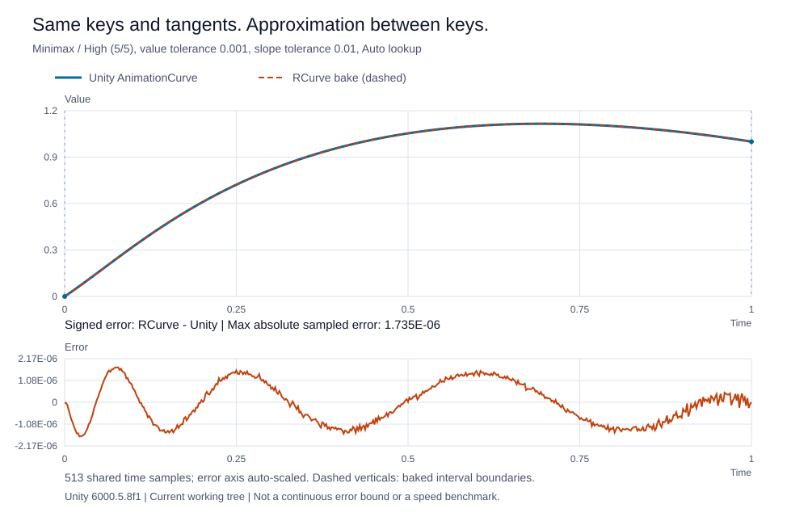
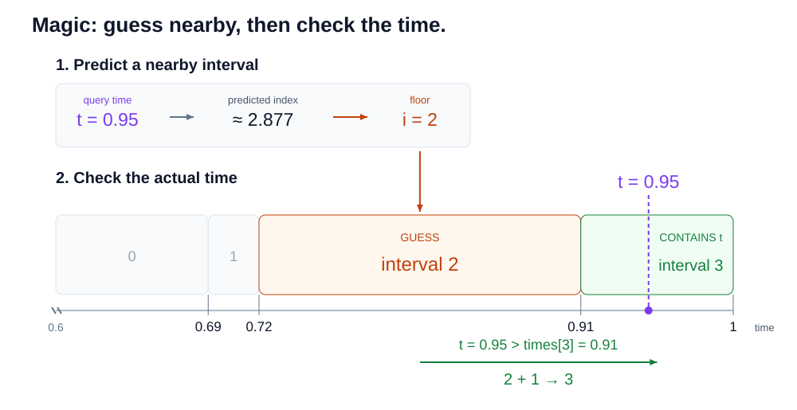

# RCurve

Rational curve baking for Unity, with managed and Burst evaluators.

**Preserves animation-key values and each finite in/out tangent as boundary constraints; approximates between keys.** Steps, discontinuous derivatives and wrapping have explicit rules. This is an experimental **0.3.1** release, not a claim of bit-identical AnimationCurve evaluation everywhere.

[Open the interactive WebGL demo](https://woojinkim1225.github.io/RCurve/).

## Install

Unity Package Manager → **Install package from Git URL**:

```text
https://github.com/WoojinKim1225/RCurve.git#v0.3.1
```

Package ID: `com.woojinkim1225.rcurve`. Requires Git and a Unity 6 editor. Do not install alongside an older `Assets/RCurve` source copy; back up/migrate that copy first to avoid duplicate assemblies/GUIDs.

## Use

```csharp
using RCurve;
using UnityEngine;

public class Motion : MonoBehaviour
{
    [SerializeField] private RationalCurve _curve = new RationalCurve();
    private int _intervalHint = -1;

    private void Update()
    {
        double value = _curve.Evaluate(Time.time); // Stateless/random access.
        // Or: _curve.Evaluate(Time.time, ref _intervalHint) for a playback stream.
    }
}
```

Edit the source in the Inspector. Expand its foldout for fitting and lookup settings. The Editor bakes after a short debounce. Defaults: **Minimax / High (5/5) / Auto lookup**.

Runtime fitting is also available for tools and user-authored curves:

```csharp
curve.Bake(); // Allocates and may be expensive; call after edits, not every frame.
```

## How it works

For every smooth source interval, RCurve converts Unity's weighted Hermite key data to a parametric cubic Bézier, samples it, then fits a positive-denominator rational Bernstein curve:

```text
P(u) = Σ pᵢ Bᵢ,ₙ(u)    Q(u) = Σ qᵢ Bᵢ,ₙ(u), qᵢ > 0    R(u) = P(u) / Q(u)
```

The endpoint numerator coefficients are determined by the key values and finite tangents. Least-squares or sampled minimax fitting chooses the remaining coefficients; intervals subdivide until sampled value and slope tolerances pass. Evaluation converts the Bernstein coefficients once to an allocation-free Horner form. See the [interactive graph](https://woojinkim1225.github.io/RCurve/) and [usage guide](Documentation~/usage.md).



Actual output from the current working tree in Unity 6000.5.8f1, using default fitting settings. The upper plot is not magnified; the lower error axis is independently scaled. This example's maximum absolute error over 513 shared time samples is about **1.73 × 10⁻⁶**, not a continuous error guarantee or a typical-case claim. [Inputs, raw data and regeneration instructions](Documentation~/graphs.md).

- `Evaluate(time)` returns the value; `EvaluateSlope(time)` returns dy/dt.
- `Evaluate(time, ref intervalHint)` optionally reuses a caller-owned interval. Do not share mutable hints between playback streams/jobs.
- `curve.BakedCurve` exposes immutable managed data.
- `curve.Bake()` fits and stores the current source in Editor or player code.
- `NativeRationalCurve.Create(curve.BakedCurve, allocator)` makes a Job snapshot. Complete readers before disposing one owner; struct copies share allocations.
- Use Burst `FloatMode.Strict` / `FloatPrecision.High`. Calling a method directly does not make it Burst-compiled.
- Failed rebakes keep the last good result in the asset and Inspector. An unbaked curve cannot be evaluated, and neither can one whose source or settings changed since its bake: the first evaluation after loading checks this and throws.

## Lookup strategies

Choose **Auto**, **BruteForce**, **LUT**, or **Magic** independently of fitting quality.

Auto uses a benchmark-calibrated cost model at bake time, with separate managed/Burst choices. LUT storage is limited to 1 KiB per curve. Magic uses a certified global index predictor plus at most one adjacent-interval correction. Binary search remains an internal candidate/fallback. Auto is an estimated policy, **not a guarantee of the fastest strategy on every CPU or access pattern**.



Orange is the guess; green contains the query. **The time does not move—the candidate interval changes.** The axis is zoomed to 0.60–1.00, with actual interval widths preserved.

**Magic predicts where to evaluate, not the animation value.** At bake time it fits a global linear/cubic map from baked key times—including subdivision boundaries—to their indices. At runtime, after time wrapping, it evaluates that map, floors and clamps the result to a candidate interval, then checks the actual boundaries. It keeps the candidate or moves one interval left/right, verifies the result, and evaluates the located segment. Exact keys return stored values.

In this actual linear-predictor example, `t = 0.95 → f(t) ≈ 2.877 → candidate 2`. Since `0.95 ≥ times[3] ≈ 0.91`, the lookup moves right to interval 3 before evaluating the curve. Failed predictor validation selects binary search; failed runtime interval verification also falls back to binary search. [Inputs and trace checks](Documentation~/graphs.md).

## Samples

In Package Manager, select **RCurve → Samples → Curve Comparison → Import**. Open the imported `Comparison.unity` scene.

- Blue: AnimationCurve. Orange: RationalCurve. Both receive the same time.
- Editable Canvas/uGUI dashboard: playback, reverse, seeking, optional hint, values and errors.
- Only the signed-error bar is magnified. Marker positions use the actual values.
- Stop Play Mode before editing/rebaking. The scene demonstrates accuracy, not reliable frame-time benchmarking.

Import **Runtime Web Demo**, add `RCurveWebDemo` to an empty GameObject in your demo scene, then enter Play Mode. It does not auto-start in unrelated scenes. Choose **2–5 equally spaced keys** and adjust each value plus independent incoming/outgoing slopes and weights (handle strengths). Unused endpoint handles are disabled. Changes bake when a slider is released; a yellow dot follows the actual RCurve evaluation in a four-second loop. The graph auto-scales vertically and shows the maximum error at 161 sampled points, not a continuous error bound. The preview uses **LeastSquares / Low** and clamped endpoints, rather than the package's default fitting settings. Weights range from 0.01 to 1; unsupported or unfittable combinations report an error and keep the last good graph and moving point. This is the source for the WebGL demo; source changes require rebuilding and publishing the player.

Run **Tools → RCurve → Check Web Demo** after importing to check baking, endpoint clamping and recovery from invalid input.

Sample scripts and their UI dependency are separate from the core runtime assemblies. The comparison sample uses Built-in unlit materials; URP/HDRP hosts may need replacement materials. Its supplied EventSystem uses the Legacy Input Manager; configure InputSystemUIInputModule/UI Actions in Input System-only hosts.

## Compatibility and limits

- API baseline: **Unity 6000.0+**. Unexecuted editor versions are not certified; see [compatibility notes](Documentation~/compatibility.md).
- Core `RCurve.Runtime` has no UnityEngine dependency. Unity serialization and fitting, Burst, Editor tooling, and sample UI are separate assemblies.
- Dependencies declare Burst 1.8.30, Mathematics 1.3.2 and uGUI 2.0.0. Newer Unity editors may resolve built-in newer versions.
- Weighted segments with stationary X are currently rejected. Fitting validates samples, not a continuous error proof.
- Some large weighted inputs can exceed the Minimax simplex iteration limit. LeastSquares is a separate explicit option, not a silent fallback.
- `EvaluateSlope` may return NaN at corners, steps and wrap seams with no common derivative. Input time is wrapped before evaluation.
- Unity JSON round-tripping can shift doubles by a few ULP. Input signatures use semantic binary data rather than editor-version-dependent AnimationCurve JSON.
- No IL2CPP/player-AOT or all-render-pipeline claim. Do not infer universal speedups from Editor measurements.

## Tests and documentation

See [testing](Documentation~/testing.md), [사용 가이드 (Korean)](Documentation~/usage.md), and [changelog](CHANGELOG.md).

Tests compare managed/Burst values and slopes, exact boundaries, weighted fits, serialization, hints and lookup strategies. Performance tests report measurements without flaky timing thresholds.

## License

[MIT](LICENSE.md). Copyright © 2026 WoojinKim1225.
